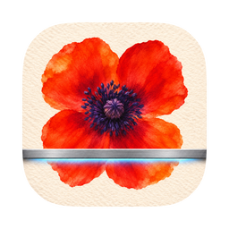
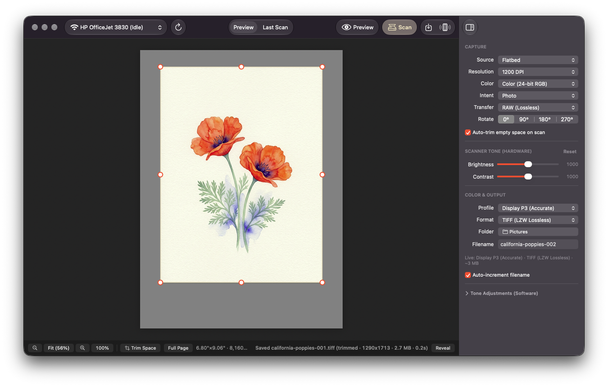
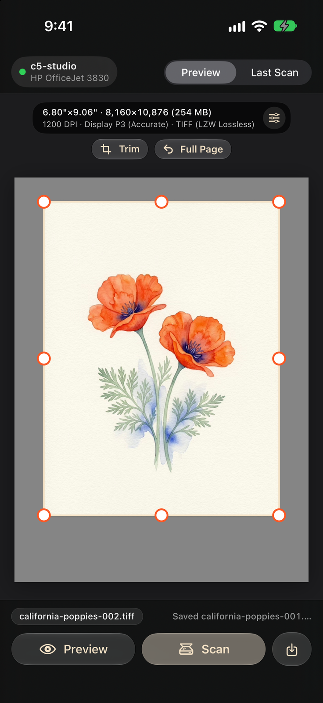
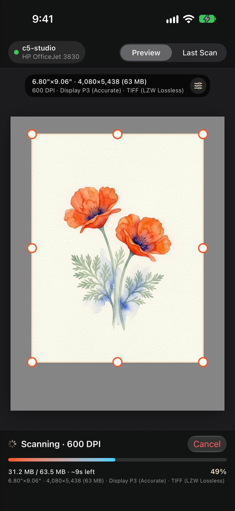
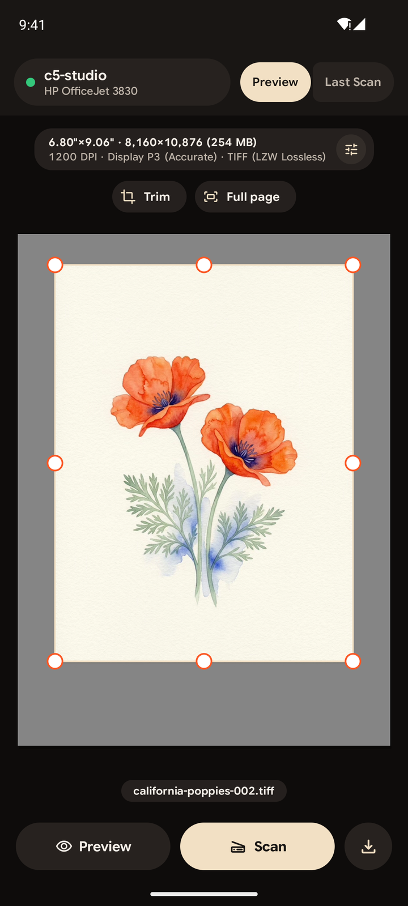
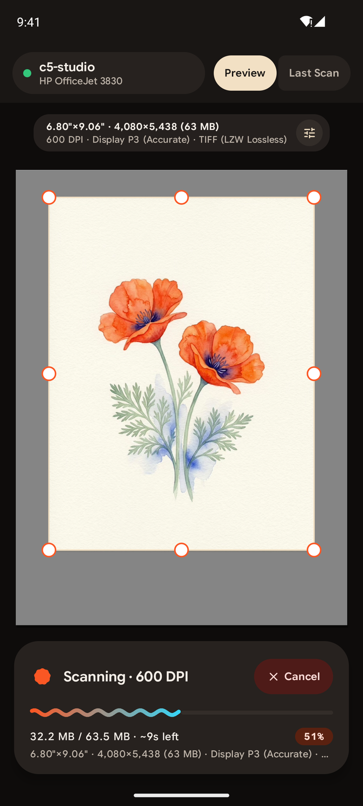

# ChromaScan

A native **AppKit** macOS scanner app for direct USB and Wi-Fi **eSCL (AirScan)** scanning with Display P3 color management, paired with **iOS** and **Android** companion apps over your local network.



## Why ChromaScan?

macOS Image Capture tags scans from many AirScan printers (such as the HP OfficeJet 3830) with legacy `Generic RGB Profile` (gamma 1.80) and lifts highlights, washing out artwork and watercolors. ChromaScan talks directly to your scanner's eSCL endpoint over USB or Wi-Fi and runs its own `Accelerate` (`vImage`) + `ImageIO` pipeline:

- Streams uncompressed `application/octet-stream` RGB24 or Grayscale8 pixel data up to 1200 DPI (or JPEG for faster previews) with `Intent=Photo`
- Tags and converts scans to **Display P3 (Convert from sRGB)**, **Display P3 (Assign — Vivid)**, or **sRGB IEC61966-2.1**
- Exports 3-channel RGB24 (no alpha channel) to **TIFF (LZW / Uncompressed)**, **PNG**, **JPEG**, and **HEIC** with DPI and ICC metadata

## Apps & Features

### macOS Host (`ChromaScan`)

- **USB & Wi-Fi eSCL discovery:** Connects directly to IPP-over-USB scanners via `IOUSBHost` and Wi-Fi scanners via Bonjour (`_uscan._tcp` / `_uscans._tcp`) or manual IP. Prefers USB when plugged in, and falls back to Wi-Fi if a printer drops into USB slow mode.
- **Scan workflow:** Flatbed and ADF support, 75–1200 DPI, hardware Brightness/Contrast, software Black Point / White Point / Gamma LUTs, 90° rotation steps, auto-trim empty space (with undo/redo), and 1:1 high-res tile inspection when zoomed in.
- **Live output preview:** Estimates output dimensions and file size as you adjust format or lossy JPEG/HEIC quality, with optional live compression preview.
- **Transfer reliability:** Rolling-window speed ETA, clean mid-transfer cancellation, and automatic cleanup of leftover eSCL jobs on the scanner.
- **Companion server:** Advertises over Bonjour (`_chromascan._tcp`) with 6-digit PIN pairing, optional menu bar background mode, and direct Mac-to-APNs push notifications.

### iOS & Android Companions

Both companion apps connect to your Mac host over local WebSocket (auto-discovered via Bonjour/NSD, or manually by IP / Tailscale) and mirror the active session: flatbed preview, drag-to-crop handles, Trim / Full Page, pinch-to-zoom with on-demand 1:1 high-res tiles, full capture/color/tone controls, filename renaming, and **Save Copy to Photos**.

- **iOS (`ChromaScanRemote` + `ChromaScanWidgets`, iOS 17+):** SwiftUI client with Display P3 previews, **Lock Screen Live Activity & Dynamic Island** scan progress with live ETA countdown, local completion alerts, and optional direct Mac-to-APNs lock-screen push notifications.
- **Android (`android/`, Android 10+):** Jetpack Compose client with Material 3 Expressive UI, wide-color-gamut rendering, and a foreground monitoring service (`ScanMonitorService`) that keeps the socket alive during multi-minute 1200 DPI scans for lock-screen progress, a Cancel action, and completion alerts without any cloud push setup.

<table>
  <tr>
    <td align="center"></td>
    <td align="center"></td>
    <td align="center"></td>
    <td align="center"></td>
  </tr>
  <tr>
    <td align="center"><sub>iOS · Preview &amp; Crop</sub></td>
    <td align="center"><sub>iOS · Live Scan Progress</sub></td>
    <td align="center"><sub>Android · Preview &amp; Crop</sub></td>
    <td align="center"><sub>Android · Live Scan Progress</sub></td>
  </tr>
</table>

## Building

### macOS App (No Apple Account Required)

Open `ChromaScan.xcodeproj` in Xcode (macOS 14+ target) and run the **ChromaScan** scheme, or build from the command line:

```bash
xcodebuild -project ChromaScan.xcodeproj -scheme ChromaScan -configuration Release build
```

If you edit `project.yml`, regenerate the Xcode project with [XcodeGen](https://github.com/yonaskolb/XcodeGen): `xcodegen generate`.

### iOS Companion (Free Apple ID or Paid Developer Account)

Personal signing settings live in gitignored `Config/Local.xcconfig` (optionally included by `Config/Base.xcconfig`), so forks can sign with their own Apple account without touching tracked files.

Run the interactive setup script (or copy `Config/Local.xcconfig.example` to `Config/Local.xcconfig`):

```bash
./scripts/setup-signing.sh
```

This sets:

- `CHROMASCAN_TEAM_ID` — your 10-character Apple Team ID (auto-detected from Keychain if signed into Xcode)
- `CHROMASCAN_BUNDLE_ID_PREFIX` — a unique reverse-DNS prefix (e.g. `com.yourname.chromascan`)
- `CHROMASCAN_MAC_CODE_SIGN_IDENTITY` — defaults to `Apple Development` when a Team ID is set so macOS Keychain and Local Network permissions survive rebuilds
- `CHROMASCAN_IOS_ENTITLEMENTS` — left blank for free Apple IDs (Apple restricts Push Notifications to paid memberships; local notifications and Live Activities still work)

Open `ChromaScan.xcodeproj`, select your iPhone, and build **ChromaScanRemote**. Free Apple ID builds must be re-signed every 7 days.

### iOS Lock-Screen Push Notifications (Optional, Paid Developer Account)

For multi-minute 1200 DPI scans while your iPhone is locked, the Mac app can send HTTP/2 pushes directly to Apple's APNs servers using `CryptoKit` with no relay server:

1. Enable the Push entitlement in `Config/Local.xcconfig` (or answer Yes in `./scripts/setup-signing.sh`):
   ```xcconfig
   CHROMASCAN_IOS_ENTITLEMENTS = Resources/ChromaScanRemote.entitlements
   ```
2. Create or reuse an APNs `.p8` key under **Apple Developer → Certificates, Identifiers & Profiles → Keys** and download `AuthKey_<KEYID>.p8`.
3. Install the key on your Mac using either method:
   - **CLI:** `./scripts/setup-apns.sh ~/Downloads/AuthKey_<KEYID>.p8` (saves to `~/.config/chromascan/apns/` with `chmod 600`)
   - **Mac UI:** Click the **iPhone Companion** toolbar button → **Configure APNs…** and pick your `.p8` file
4. Rebuild **ChromaScanRemote** to your physical iPhone, pair with your Mac, and use **Send Test Push** in the Companion popover to verify delivery.

### Android Companion

Open `android/` in Android Studio, or build and install with Gradle (JDK 17+):

```bash
cd android
./gradlew assembleDebug    # APK at android/app/build/outputs/apk/debug/app-debug.apk
./gradlew installDebug     # Install directly to a connected device or emulator
```

## Project Layout

| Path | Description |
| --- | --- |
| `Sources/Core` | Shared models, `vImage`/`ImageIO` pipeline, theme, companion protocol, Live Activity attributes |
| `Sources/MacHost` | AppKit macOS app, eSCL client, Bonjour + IPP-over-USB (`IOUSBHost`) discovery, companion WebSocket & APNs host |
| `Sources/iOSCompanion` | SwiftUI iOS companion app (`ChromaScanRemote`) |
| `Sources/Widgets` | WidgetKit Live Activity & Dynamic Island extension (`ChromaScanWidgets`) |
| `android/` | Jetpack Compose / Material 3 Expressive Android companion app |
| `Tests/` | Unit and integration tests for Mac host, USB transport, companion protocol, and iOS store |
| `scripts/` | Signing (`setup-signing.sh`) and APNs key (`setup-apns.sh`) helpers |
